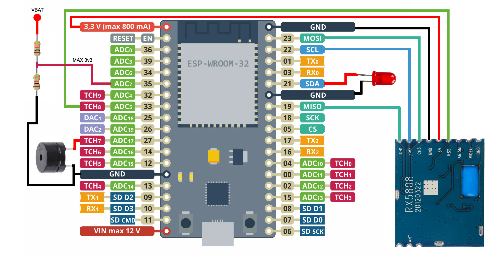

# 骑云 FPV 竞速计时系统（QiYun-LapTimer-Node）

[](https://opensource.org/licenses/MIT)

一台**低成本、单节点**的 5.8GHz FPV 穿越圈速计时器。整台设备只有两块板子——ESP32 + RX5808 图传接收模块——自带 Web 配置页面，手机/平板/笔记本连上它的 WiFi 就能用，不需要装任何 App。

整机物料约 **¥250–270** 起（RX5808 模块是主要成本项），接线三根信号线加电源线，烧录两条命令，配网后即可计时。外壳可选：仓库附带两半式 3D 模型与 Bambu Studio 切片工程（[docs/3d/](docs/3d/README.md)），裸跑或洞洞板也完全可以。



**基于** [PhobosLT](https://github.com/phobos-/PhobosLT) / [RotorHazard](https://github.com/RotorHazard/RotorHazard) 的 RSSI 峰值计时思路，面向国内场景做了定制：

| 相对上游的改动 | 说明 |
|---|---|
| 多芯片支持 | 经典 ESP32 与 C3 / S3 有现成构建环境；S2 有引脚表但需自建 `[env:...]` |
| 飞机尺寸自适应 | 2 寸 / 5 寸机对应不同计时门直径与判定阈值，不必手算 RSSI |
| 中文 Web UI | 配置 / 比赛 / 校准 / 更新四个页签，自动校准向导 + 浮窗提示 |
| 语音播报 | 浏览器 TTS 播报单圈或累计用时，支持播报速率调节 |
| 训练数据上云 | 停止计时后自动 POST 到自建平台，含圈速明细与飞手 ID |
| 双通道 OTA | 固件 + 文件系统均可网页更新，无需拆机插线 |

---

## 完整文档在 `docs/`

本 README 只做入口。**[docs/](docs/README.md) 才是唯一出处**，按三个视角编排：

| 文档 | 内容 | 适合谁 |
|---|---|---|
| [01-project-overview.md](docs/01-project-overview.md) | 产品定位、[工作原理](docs/01-project-overview.md#2-工作原理)、系统架构、网络模式、技术选型、上云链路、安全边界 | 想搞清"这是什么、怎么工作" |
| [02-user-manual.md](docs/02-user-manual.md) | [物料](docs/02-user-manual.md#1-物料准备) → [接线](docs/02-user-manual.md#2-接线) → [烧录](docs/02-user-manual.md#3-固件烧录) → [首连](docs/02-user-manual.md#4-首次连接) → [配置](docs/02-user-manual.md#6-配置页参数详解) → [校准](docs/02-user-manual.md#7-校准最关键的一步) → [比赛](docs/02-user-manual.md#8-比赛流程) → [上云](docs/02-user-manual.md#9-训练数据上云) → [OTA](docs/02-user-manual.md#10-ota-在线更新免拆机) → [故障排除](docs/02-user-manual.md#12-故障排除速查) | DIY 组装者与赛场操作员 |
| [03-development-guide.md](docs/03-development-guide.md) | 项目结构、[三上下文运行时模型](docs/03-development-guide.md#2-运行时模型改代码前务必理解)、HTTP/SSE API 参考、配置持久化、改动落点、[已知限制](docs/03-development-guide.md#7-已知限制动手前值得知道) | 二次开发者、上位机/云平台对接方 |
| [3d/README.md](docs/3d/README.md) | [外壳 3D 模型清单](docs/3d/README.md#文件清单)、实测几何尺寸、Bambu Studio 成型参数、换材料与验收要点 | 要打印外壳的人 |

这四份 Markdown 是**所有说明内容的唯一出处**——仓库里不再有并行的 HTML 副本或第二份手册。GitHub 页面会直接渲染它们；离线阅读用任意 Markdown 查看器（`cat docs/02-user-manual.md` 也完全可读），需要打印就在编辑器里导出。

**该看哪份？** 想焊一台 → 02；想知道为什么这么判圈 → 01；想改代码或对接云端 → 03。

---

## 最短路径：从两块板子到出圈速

下面 7 步是"能跑起来"的最小集合，**每一步的细节、坑和原理都在链接里**。

| # | 做什么 | 关键点 | 详见 |
|---|---|---|---|
| 1 | RX5808 做 **SPI 改造** | 短接锡饼 + 引出 CH1/CH2/CH3，否则无法改频 | [02 §1](docs/02-user-manual.md#1-物料准备) |
| 2 | 按芯片型号接线 | ⚠️ RX5808 的 `+5V` 引脚**故意接到 ESP32 的 `3V3`**（欠压供电以提高 RSSI 分辨率）；四款芯片引脚表不同 | [02 §2](docs/02-user-manual.md#2-接线) |
| 3 | 装 VS Code + PlatformIO，clone 本仓库 | 首次构建自动下载 `espressif32@6.9.0` 与四个依赖库，需联网几分钟 | [02 §3.1](docs/02-user-manual.md#31-环境搭建) |
| 4 | **两条命令，缺一不可** | 先 `-t upload` 烧固件，再 `-t uploadfs` 烧网页；只烧固件的话设备能跑但页面空白 | [02 §3.2](docs/02-user-manual.md#32-编译与烧录两条命令缺一不可) |
| 5 | 手机连热点 `QYLPT_XXXX`，密码 `12345678`，打开 `http://33.0.0.1` | 没自动弹出就手动输地址；配好自己 WiFi 后走 STA 模式 | [02 §4](docs/02-user-manual.md#4-首次连接) |
| 6 | 「配置」页选频段/频道（**必须与飞机 VTx 一致**）+ 飞机大小（2 寸 / 5 寸） | 频段频道查表得频率；飞机尺寸决定计时门直径与判定阈值 | [02 §6](docs/02-user-manual.md#6-配置页参数详解) |
| 7 | 「校准」页走三步向导 | 飞机通电**等 30 秒**让 VTx 达工作温度 → 起飞点采底噪 → 确认应用。**信号强度差低于页面「要求 ≥」值（2 寸 35 / 5 寸 19）说明阈值不可靠** | [02 §7](docs/02-user-manual.md#7-校准最关键的一步) |

之后：「比赛」页点**开始** → 过圈逐行累加 → 点**停止**（配好飞手 ID 且已联网则自动上云）。

> ℹ️ **第一行是"开圈"，没有成绩，这是正常的。** 按下开始后的第一次过门只用来对齐相位，从第二次过门起才是第 1 圈。详见 [01 §2.4](docs/01-project-overview.md#24-开圈约定)。

---

## 速查

| 项 | 值 |
|---|---|
| 默认热点 / 密码 / 地址 | `QYLPT_XXXX`（`XXXX` = MAC 去冒号后的末 4 位十六进制）/ `12345678` / `http://33.0.0.1`、`http://qylpt.local` |
| 构建环境 | `esp32dev`、`esp32doit-devkit-v1`、`esp32-c3-devkitm-1`、`esp32-s3-devkitc-1`（[platformio.ini](platformio.ini)） |
| 烧录 | `pio run -e esp32dev -t upload --upload-port <端口>` → `pio run -e esp32dev -t uploadfs --upload-port <端口>` |
| 网页文件 | `data/` 整个目录 = LittleFS 镜像，改完只需重跑 `-t uploadfs` |
| 引脚定义唯一来源 | [lib/config.h:28](lib/config.h#L28) 的 `#define`；同文件 [:5](lib/config.h#L5) 是接线表注释，**改引脚必须同时改这两处** |
| RSSI 引脚限制 | 必须落在 **ADC1**（经典 ESP32 用 GPIO33）；GPIO25/26 属 ADC2、与 WiFi 共用不可用；GPIO34/35/36/39 只能输入不能输出 |
| 外壳打印 | Bambu Lab A1 · 0.4 喷嘴 · PETG · 层高 0.2 · 壁 4 · 填充 35 % gyroid · 树状支撑 · 无 brim，见 [docs/3d/](docs/3d/README.md#成型参数3mf-内实际记录值)；线上发布页 <https://www.crealitycloud.cn/model-detail/6ad9d953328846f6477a79e6> |
| 上云接口 | `POST <API地址>/training/device_upload`，字段见 [01 §6](docs/01-project-overview.md#6-训练数据上云可选) |
| 固件 / 文件系统 / 配置版本 | `1.0.9` / `1.0.7` / `4U`（[debug.h](lib/debug.h)、[config.h](lib/config.h)），**全部手工维护** |

---

## 目录结构

```
QiYun-LapTimer-Node/
├── src/main.cpp                装配所有模块 + 双上下文调度
├── platformio.ini              4 个构建环境，依赖锁定版本
├── builder.py                  把平铺在 lib/ 根的源码接入构建（PIO 默认不编译 lib/ 根）
├── partitions.csv              双 OTA + LittleFS 分区表（铺满 4 MB）
├── data/                       ← 整个文件夹 = LittleFS 镜像（改这里只需 uploadfs）
│   ├── index.html              四页签单页应用
│   ├── script.js               前端逻辑：频段查表、校准向导、SSE、TTS、圈速表
│   ├── style.css / smoothie.js / articulate.min.js / jquery-3.7.1.min.js
│   ├── favicon.ico             页面图标 + 首页 logo
│   └── update/index.htm        OTA 上传页（被 iframe 内嵌）
├── lib/                        固件全部模块，17 个源文件同级平铺：
│                               config / RX5808 / kalman / laptimer / webserver
│                               / led / buzzer / battery / debug
└── docs/                       ← 完整文档（本 README 只作入口）
    ├── README.md               文档中心
    ├── 01-project-overview.md  项目说明
    ├── 02-user-manual.md       操作手册
    ├── 03-development-guide.md 开发指南
    ├── assets/wiring-esp32.png 接线示意图
    └── 3d/                     外壳 3D 模型（case-base.stl / case-lid.stl
                                / enclosure-bambu-studio.3mf）+ 打印参数说明
```

---

## 使用前请知悉的三件事

1. **更新与配置接口没有任何鉴权。** 同一局域网内任意设备都能刷写固件与网页，`GET /config` 还会明文回显 WiFi 密码。请只在可信网络使用，**不要暴露到公共 WiFi 或做端口映射**。详见 [01 §7 安全边界](docs/01-project-overview.md#7-安全边界必读)。
2. **「退出阈值」滑块当前无效。** 它会被保存和回显，但过圈判定用的是 `minDelta`（由门径决定），调它不改变计时行为。这是待修的历史遗留，别把它当成"校准坏了"。
3. **圈速表、累计用时、播报类型只存在浏览器里，刷新即丢。** 播报类型还额外记在 `localStorage`，优先级高于设备配置——换手机看到的播报设置可能不一样。重要场次请先配好数据上云，可靠记录以云端为准。

其余已知限制（JSON 截断、`POST /config` 缺字段清零、停止计时时同步发 HTTP、跨核读写无同步等）见 [03 §7 已知限制](docs/03-development-guide.md#7-已知限制动手前值得知道)。

---

## 贡献

欢迎提 Issue 和 PR。修复上面第 1、2 条以及已知限制里的 JSON 截断问题尤其受欢迎——动手前建议先开 Issue 对齐方案。

问题反馈：**https://github.com/onebody/QiYun-LapTimer-Node/issues**

改代码前务必先读 [03 §2 运行时模型](docs/03-development-guide.md#2-运行时模型改代码前务必理解)——路由 handler 里做阻塞操作会卡死整个 Web 服务和 SSE。

## 许可与版权

**本项目采用 MIT 许可证**，完整条款见 [LICENSE](LICENSE)：

- 版权持有：**Copyright (c) 2026 onebody**
- 你可以自由地使用、复制、修改、合并、发布、再分发、以及商用本仓库的源代码与文档，**无须付费、无须申请**。
- 唯一条件：**在所有副本或实质部分中保留上述版权声明与本许可声明**——也就是删除 `LICENSE` 里的版权行、或把署名换成你自己，都不被允许。
- 软件按"现状"提供，**不含任何担保**；作者不对使用它造成的任何损失负责（炸机、数据丢失、赛场纠纷均在免责范围内）。

### 第三方组件与其许可

本仓库内联或依赖的第三方部件**各自保留原始许可证，不受本项目 MIT 条款覆盖**。分发或二次开发时请一并保留它们的文件头/许可声明：

| 部件 | 位置 | 许可 |
|---|---|---|
| [AsyncTCP](https://github.com/esp32async/AsyncTCP) 3.4.10 | 构建依赖 | 上游仓库声明为 LGPL-3.0 并附带编译/运行时链接例外，**以其仓库 LICENSE 为准** |
| [ESPAsyncWebServer](https://github.com/esp32async/ESPAsyncWebServer) 3.9.4 | 构建依赖 | 同上（LGPL 系，例外条款允许静态链接使用），**以其仓库 LICENSE 为准** |
| [ArduinoJson](https://arduinojson.org) 7.2.0 | 构建依赖 | MIT（Copyright Benoît Blanchon） |
| [ElegantOTA](https://github.com/ayushsharma82/ElegantOTA) ^3.1.7 | 构建依赖 | MIT |
| jQuery 3.7.1 | `data/jquery-3.7.1.min.js`（内联） | MIT —— 文件头保留 `jquery.org/license` 与 OpenJS Foundation 版权声明 |
| Smoothie Charts | `data/smoothie.js`（内联） | MIT —— 文件头保留 Joe Walnes / Drew Noakes 版权声明 |
| articulate.js | `data/articulate.min.js`（内联） | **文件内没有任何许可或版权声明**，来源 <https://github.com/acoti/articulate.js>；商用或再分发前请先向上游确认授权 |

内联文件的许可头**请勿在压缩/替换时删除**。构建依赖的版本锁定见 [platformio.ini](platformio.ini)；不要随意升级 `espressif32` 平台版本，分区表与 LittleFS 行为会跟着变。

### 信息与思路引用

本计时器不是从零发明的，下列工作是它的直接输入，引用在此明示：

- **[PhobosLT](https://github.com/phobos-/PhobosLT)**（[phobos-](https://github.com/phobos-)）— 单节点 RSSI 峰值计时方案、硬件选型与接线思路的主要来源；本仓库文档的步骤编排亦参考其 README。
- **[RotorHazard](https://github.com/RotorHazard/RotorHazard)** — 5.8GHz 频段频道表、RX5808 寄存器时序、RSSI 缩放系数的底层实现参照。
- **[ExpressLRS](https://github.com/ExpressLRS/ExpressLRS)** — 工具链与构建流程约定。
- **外壳 3D 模型**由本项目作者原创，随仓库 MIT 释出，同步发布于 [Creality Cloud](https://www.crealitycloud.cn/model-detail/6ad9d953328846f6477a79e6)（模型名「单人版无人机竞速计时器外壳」）；文件在 [`docs/3d/`](docs/3d/README.md)。
- **RX5808 SPI 改造指南**（Shea Ivey，<https://sheaivey.github.io/rx5808-pro-diversity/docs/rx5808-spi-mod.html>）— 动手接线前必读的外部教程。
- **Arduino / ESP-IDF / PlatformIO / Espressif** — 编译与运行环境。

> **硬件原理图尚未随本仓库提供**——`docs/assets/wiring-esp32.png` 是文档配图，不等同于可制造的原理图，电气连接以引脚表为准。**外壳 3D 模型已提供**：`docs/3d/` 内两个 STL 加一份可直接切片的 Bambu Studio 工程。

### 关于上游许可的处理

本项目在上游思路之上重写并独立发布，以 MIT 释出；若后续直接摘取上游代码片段，请在提交信息中注明来源与该片段的许可证（RotorHazard 为 GPLv3，**GPL 代码不可并入本 MIT 发布**，只可参考其公开文档与算法思路）。
