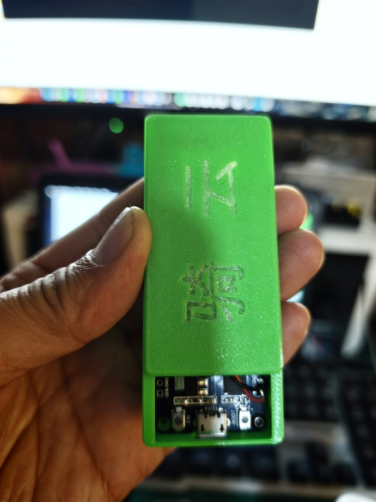

# 外壳 3D 模型与打印参数

计时器整机的两半式塑料外壳，含可直接切片的 Bambu Studio 工程。装配位置与接线见 [《操作手册》§2 接线](../02-user-manual.md#2-接线)，本文件只负责"外壳本身怎么打、打得对不对"。

**先说一件容易踩的事**：仓库里的 `case-lid.stl` 与 `.3mf` 都是**无刻字的光面版本**（上盖顶面只有 8 个顶点落在 z≈11.5，没有任何文字凹槽）。下面照片与渲染图里上盖的「骑云」二字来自另一版模型，**按本目录文件打印不会得到刻字效果**。想要刻字需在切片前自行加浮雕/凹刻特征。

**线上发布页**：<https://www.crealitycloud.cn/model-detail/6ad9d953328846f6477a79e6>（模型名：**单人版无人机竞速计时器外壳**，作者即本仓库作者）。在本页「下载模型」拿到的压缩包与本目录文件同源；若页面版本更新，以页面为准，并欢迎把新版本回填到仓库。没有 Creality Cloud 账号也能直接用本目录里的三个文件，不必去线上下载。

## 文件清单

| 文件 | 内容 | 说明 |
|---|---|---|
| [`case-base.stl`](case-base.stl) | 底座，126 KB，2518 三角面 | 二进制 STL，80 字节头带 `STLB ATF ... COLOR=`（含颜色信息） |
| [`case-lid.stl`](case-lid.stl) | 上盖，119 KB，2384 三角面 | 二进制 STL，头字段为空（无颜色信息）；**光面无刻字** |
| [`enclosure-bambu-studio.3mf`](enclosure-bambu-studio.3mf) | Bambu Studio 工程，87 KB | 几何已内嵌（2519 / 2385 面，与两个 STL 同一版模型），含下表的完整成型参数与盘上排布 |
| [`preview-plate.png`](preview-plate.png) | 盘上排布示意图 | 从 3MF 缩略图（`Metadata/plate_1.png`）解出，仅供文档展示 |
| [`printed-sample.jpg`](printed-sample.jpg) | 打印样机实拍（787×1050） | 上盖 + 装入 ESP32 的底座；已抹除 EXIF |
| [`printed-lid.jpg`](printed-lid.jpg) | 上盖特写实拍（507×900） | 同上，已抹除 EXIF；图中刻字非本目录模型所出 |
| [`assembly-render.jpg`](assembly-render.jpg) | 装配效果渲染图（1200×925） | 切片/CAD 视图，用于说明合盖后的外观与开孔位置 |

**优先用 `.3mf`**：拖进 Bambu Studio 即得到与作者一致的机器、耗材、支撑与排布设置。只有当你用别的切片软件（PrusaSlicer / Cura / 嘉立创三维猴等）时，才需要分别导入两个 `.stl` 并按下表手工回填参数。

> 3MF 内部的 `source_file` 元数据仍记录早期文件名（`外壳底座.stl` / `实体1.stl`）。几何是内嵌的，不影响打开；但若你在切片软件里选择"重新导入散件"，请用上面已改好的英文文件名。

## 几何事实（从模型顶点直接量得，单位 mm）

| 项 | 底座 | 上盖 |
|---|---|---|
| 外形 X × Y | 33.0 × 65.2 | 33.2 × 65.4 |
| 高度 Z | 15.0 | 11.5 |
| 合盖总高 | 26.5 | — |
| 上下盖对应孔位 | 一对，位于 (±14.7, 32.4)，与上盖 (±14.4, 31.1) 对应 | 同左，**孔距 28.8** |
| 底面边缘附加孔位 | 一对，位于 (±4.2, −32.0) | — |
| 侧壁开口 | 一处矩形通口 | — |
| 内腔 | 约 29 × 61（外形减去四壁），容纳 **ESP32 开发板 + RX5808 模块整机** | 压合口 |

上表只列可复测的几何量，**各开孔对应哪个器件请以上机试装为准**——先干跑一次装配（不焊线，把板子放进底座）再决定要不要修孔。

## 成型参数（`.3mf` 内实际记录值）

| 项 | 值 |
|---|---|
| 切片软件 | Bambu Studio 02.08.04.57 |
| 机型 / 喷嘴 | Bambu Lab A1 / 0.4 mm 标准喷嘴 |
| 层高 | 0.2 mm（该设置允许 0.08–0.28） |
| 壁 | 4 圈，顺序 inner/outer，壁与填充咬合已开 |
| 顶 / 底壳 | 各 4 层，表面 zig-zag |
| 稀疏填充 | **35 % gyroid**，方向 45° |
| 支撑 | 开启，**树状支撑 tree(auto) / tree_organic**，分支角 45° |
| Brim / Raft | 都关闭（`no_brim`、raft 0 层） |
| 接缝 | 后置（`seam_position = back`） |
| 首层线宽 | 0.5 mm |
| 速度 | 外壁 150 / 内壁 300 / 填充 200 / 桥接 50 mm/s |
| 耗材槽位 | 两个零件都分配到**槽位 2**：Generic PETG，1.75 mm，喷嘴 255 °C（首层同温），料色 `#76D9F4` |

工程里 4 个槽位都装了料（PETG / PETG / PLA / PETG，单挤出多材料模式），但**实际只有槽位 2 参与打印**——单机单料直接放一卷 PETG 即可，不必凑齐 AMS 四格。

### 换材料时的调整

作者用的是 **PETG @ 255 °C**。想换 PLA：喷嘴降到 210–220 °C、首层降到 190–200 °C、可关冷却风扇到 100 %；外壳要放在户外日晒场地时**不建议 PLA**（夏天车内/暴晒下会软化变形，PETG 玻璃化温度更高）。ABS/ASA 需要封箱与热床，A1 开放式机型不合适。

## 打印与验收要点

1. **两个零件同盘打印**，排布见 [`preview-plate.png`](preview-plate.png)；底座口朝下、上盖外面朝下各一次成型，无需中途翻面（若你的切片器把上盖压合口朝下摆放，注意检查树状支撑是否会咬住卡合面）。
2. 树状支撑会落在侧壁开口与内腔台阶上，**拆支撑后用小刀修平开口边缘**，否则 RX5808 天线与供电线会被顶起来、盖子压不严。
3. 合盖前先在无支撑状态下空合一次：四壁应贴合、孔位对正、无持续弹性顶起。合不上的常见原因是顶壳层数或壁圈数被改大。
4. 上机试装：ESP32 开发板 + RX5808 平放底座，**RSSI 线与 CH1/CH2/CH3 走线避开侧壁开口内侧**；`+5V → 3V3` 这条欠压线在壳内要保持远离 RX5808 天线（详见 [02 §2](../02-user-manual.md#2-接线)）。
5. 计时器需要"离门近、信号强"，外壳材质对 5.8GHz 基本透明（PLA/PETG 介电损耗很小），**但不要在壳内壁贴金属箔或碳纤补强**，那会直接毁掉 RSSI 曲线。
6. 蜂鸣器与板载 LED 需要听到/看到：把发声孔与 LED 对准侧壁开口或自行扩孔，别糊在实心壁后面。

## 改模型

仓库里**没有参数化源文件（无 STEP / Fusion 工程 / SCAD）**，只有三角化后的 STL 与切片工程。要改尺寸（换更大的开发板、加天线穿孔、改孔距）需要网格级编辑（Meshmixer / Blender）或按上表尺寸重画。改完请把新 STL 一并放回本目录并更新上面的几何表。

## 许可

本目录的三个模型文件（`case-base.stl` / `case-lid.stl` / `enclosure-bambu-studio.3mf`）**由本仓库作者原创并随仓库整体按 MIT 释出**，与代码同一条款：可自由使用、修改、商用与再分发，条件是保留版权声明（Copyright (c) 2026 onebody）。完整条款见根 [README.md 的「许可与版权」](../../README.md#许可与版权) 与 [`LICENSE`](../../LICENSE)。

