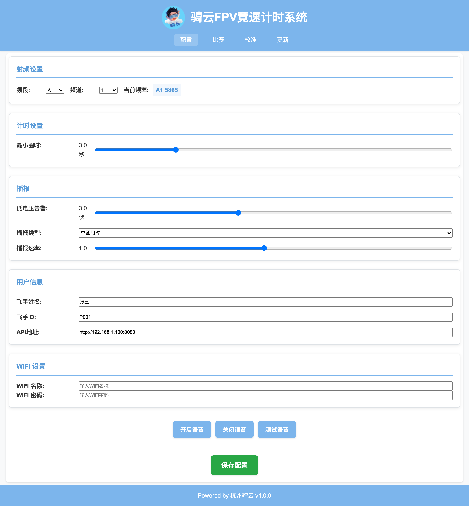
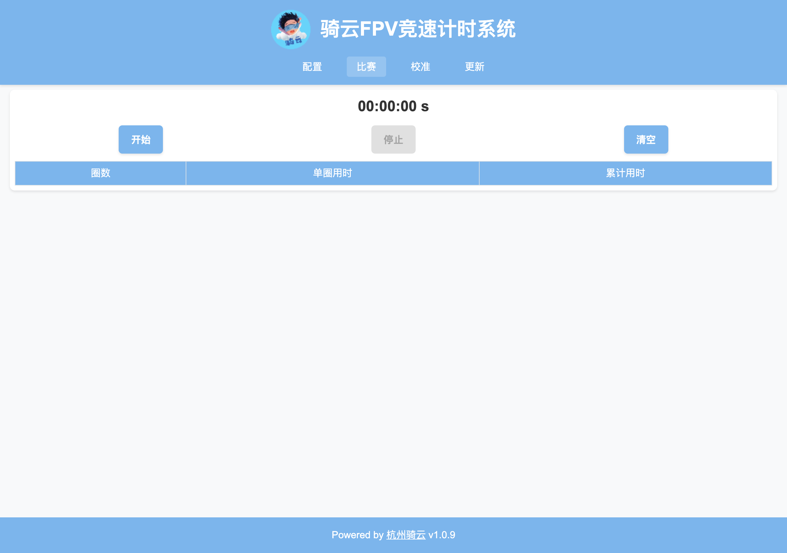
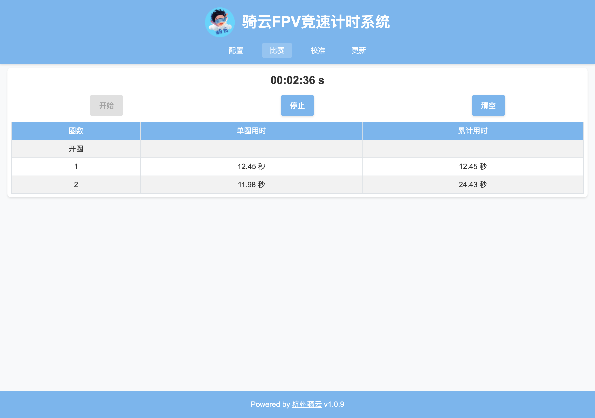
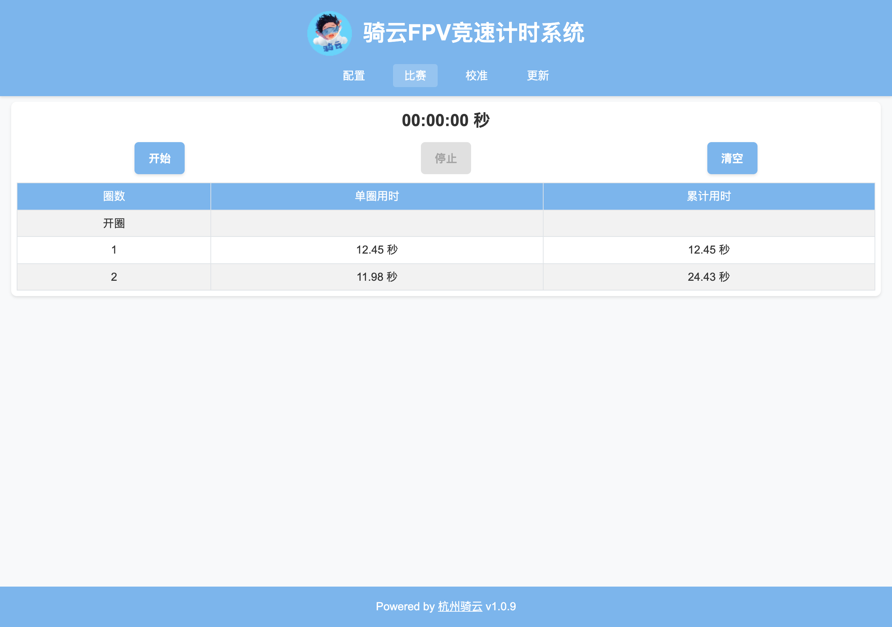
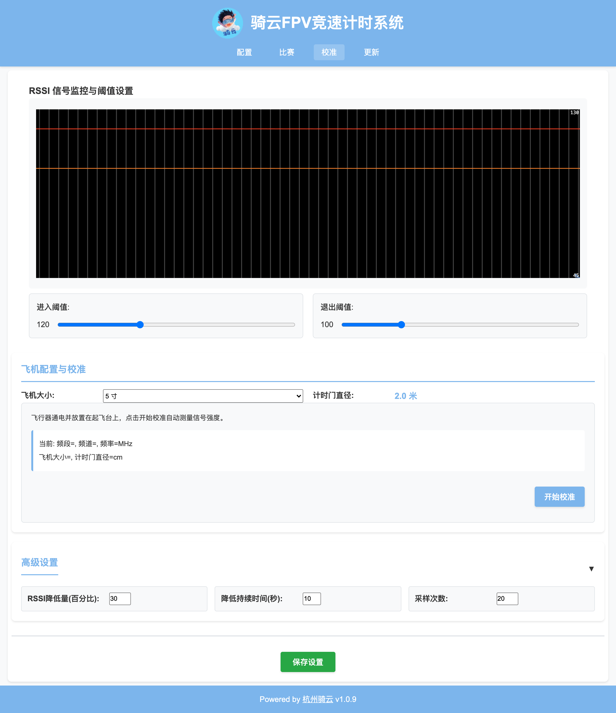
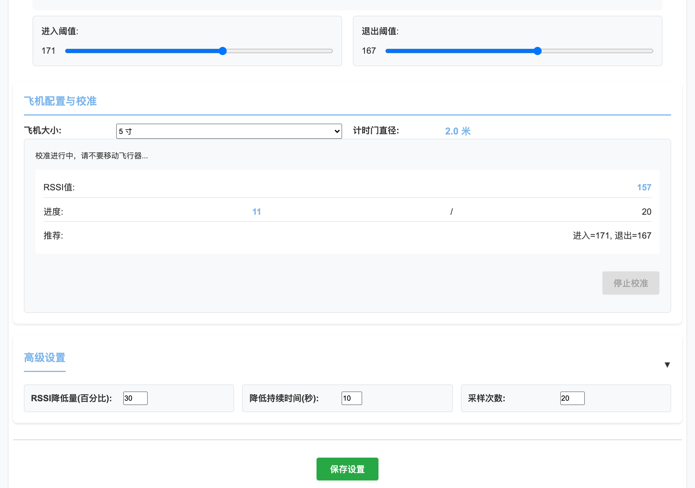
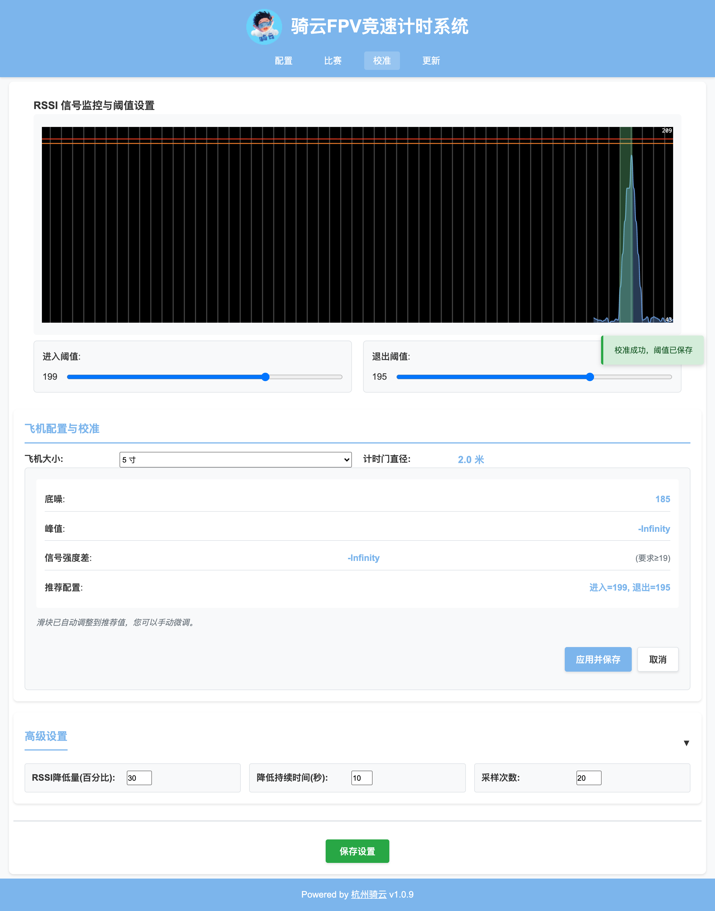
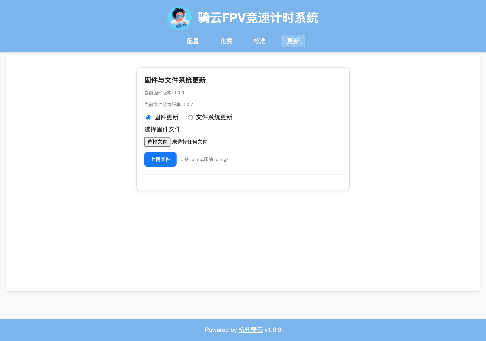

# Web 页面计时操作图文指南

面向第一次打开这个网页的人：从打开页面到 OTA 更新，每一步点哪里、会看到什么、什么状态算正常。

硬件物料、接线、烧录见 [02-操作手册](../02-user-manual.md)；RSSI 峰值判圈原理见 [01-项目说明](../01-project-overview.md)。本文只讲**页面操作**，不重复硬件与原理内容。

> **截图来源**：全部截图是仓库内真实前端（`data/` 目录）在浏览器中的实际渲染——用 [tools/mock_server.py](tools/mock_server.py) 在无真机环境模拟固件的 REST/SSE 接口，再以无头 Chrome（1280×900，2x）逐页截取。按钮的启用/禁用、计时器格式、校准数值都是前端真实逻辑的输出，不是手绘示意图。对应固件 1.0.9 / 文件系统 1.0.7。复现方法见文末附录。

## 0. 打开页面与四个页签

- **地址**：AP 模式 `http://33.0.0.1`（或 `http://qylpt.local`）；STA 模式用路由器分配的 IP 或同一个 mDNS 主机名（见 [02 §4](../02-user-manual.md#4-首次连接)）。
- **页签**：配置 / 比赛 / 校准 / 更新，当前页签高亮显示。
- 页面加载后即建立 SSE 长连接：校准页的 RSSI 曲线、比赛页的过圈事件都靠它实时推送。**曲线停走 = 连接断了**，刷新页面即可重连。
- **语音播报需要先点一次配置页的「开启语音」**：浏览器自动播放策略要求用户手势授权，否则只有蜂鸣、没有语音。

## 1. 配置页：赛前一次性设置



| 区块 | 控件 | 说明 |
|---|---|---|
| 射频设置 | 频段 + 频道 → 当前频率 | 截图为 A 段 1 道 = A1 5865 MHz，须与飞机图传一致；多机同场错开频道 |
| 计时设置 | 最小圈时 | 截图 3.0 秒：短于该间隔的过线不记圈，用于防抖、防炸机后连跳 |
| 播报 | 低电压告警 / 播报类型 / 播报速率 | 播报类型选单圈用时、累计用时或关闭 |
| 用户信息 | 飞手姓名 / 飞手ID / API地址 | 姓名与 ID 用于语音播报和上云标识；API地址为上云接口（见 [02 §9](../02-user-manual.md#9-训练数据上云)） |
| WiFi 设置 | WiFi 名称 / 密码 | 留空 = 保持 AP 模式；填写后保存并重启进入 STA 模式 |
| 语音按钮 | 开启语音 / 关闭语音 / 测试语音 | 见 §0 的自动播放限制 |
| 保存配置（绿色） | —— | **唯一落盘入口**：任何修改不点它都不生效 |

> 改完必须点「保存配置」。WiFi 变更保存后需重启设备生效。

## 2. 比赛页：空闲状态



- 计时器 `00:00:00 秒`；**开始**蓝色可点、**停止**灰色禁用；圈速表为空。
- 赛前核对三件事：频道与图传一致（§1）、语音已开启（§0）、阈值已校准（§5）。

## 3. 开始比赛与过圈



- 点**开始**：语音「比赛即将开始」+ 三声蜂鸣，约 4 秒倒计时；结束后计时器走字、**停止**变蓝、**开始**变灰（防连点误触）。
- **第一次过线记为「开圈」**，单圈/累计留空；之后每过一线记一圈，给出单圈用时与累计用时。
- 截图状态：开圈之后第 1 圈 12.45 秒、第 2 圈 11.98 秒，累计 24.43 秒；计时器格式为 `分:秒:百分秒`。
- 过圈同时按配置的播报类型语音；最小圈时内的信号抖动不会记圈。

## 4. 停止与清空



- 点**停止**：计时器归零为 `00:00:00 秒`，**停止**变灰、**开始**恢复可点；**圈速表保留**，供赛后抄录或上云。
- 点**清空**：清空圈速表并重置圈号，下一场从「开圈」重新计。
- 停止只结束本页计时，设备端 RSSI 采集不受影响，校准页曲线仍实时刷新。

## 5. 校准页：三步向导

校准确定「多强的信号算过门」，做不好会漏圈或多圈。判圈原理与可靠性判断见 [02 §7](../02-user-manual.md#7-校准最关键的一步)，这里只讲页面操作。

先在「飞机配置与校准」区选好**飞机大小**（截图为 5 寸 → 计时门直径 2.0 米，页面同步显示）。该选择决定门径与固件判圈门槛，**选错会直接导致漏判**。

### 第 1 步：开始校准



- 飞机按**实际比赛功率**通电、放在起飞点（离门一个门径以上），点**开始校准**。
- 上方曲线实时刷新 RSSI；红、橙两条横线是当前进入/退出阈值。
- 「当前: 频段=…」一行在点击开始校准后才填充（前端在开始校准时才写入），截图为点击前状态，属正常现象。

### 第 2 步：采样进行中



- 自动采样 20 次（约 4 秒；「高级设置 → 采样次数」可改），面板显示当前 RSSI 值、进度（截图 11 / 20）与实时推荐阈值，滑块同步移动。
- **采样窗口内不要移动飞机、不要有任何人过门**——任何过门峰值都会被计入底噪（见第 3 步缺陷说明）。

### 第 3 步：结果确认与保存



- 面板给出底噪、峰值、信号强度差（附「要求 ≥」参考值，5 寸机为 19）与推荐配置；滑块已自动就位。点**应用并保存**写入，点**取消**关闭面板。
- 截图里的 `-Infinity` 不是截图出错，而是同版本真机的实际行为（mock 刻意复刻了这条缺陷，见文末附录）：

> ⚠️ **已知缺陷（固件 1.0.9 / 前端同版本）**
> - **现象**：第 3 步的「峰值」「信号强度差」恒显示 `-Infinity`，「推荐配置」不可信。
> - **原因**：固件的底噪统计取采样窗口内 RSSI 最大值（`lib/LAPTIMER/laptimer.cpp:83-86`），而前端用「大于底噪 + 5 的样本」求峰值（`data/script.js:381`）；两个窗口完全重叠，过滤结果恒为空集。
> - **影响**：向导采样结束会自动保存一次配置（`data/script.js:405`），写入的是这条不可信路径算出的阈值；「取消」只关面板，不撤销这次保存。
> - **现场应对**：以第 2 步采样期间的实时推荐值为参考；或向导结束后按 [02 §7 手动兜底法](../02-user-manual.md#手动兜底法向导不可用时) 读曲线底噪 N 与过门峰值 P 手动设置滑块，再点「应用并保存」/「保存设置」覆盖。保存后务必试飞验证"只有过门才触发"。

## 6. 更新页：OTA 在线更新



- 页面显示当前固件版本与文件系统版本；单选**固件更新**或**文件系统更新**。
- 「选择文件」选 `.bin` 或压缩的 `.bin.gz`，点**上传固件**；上传与刷写期间**不要断电**，完成后设备自动重启（详见 [02 §10](../02-user-manual.md#10-ota-在线更新免拆机)）。

## 7. 比赛页按钮状态速查

| 场景 | 开始 | 停止 | 计时器 | 圈速表 |
|---|---|---|---|---|
| 空闲 | 蓝·可点 | 灰·禁用 | `00:00:00 秒` | 空 |
| 倒计时（约 4 秒） | 灰·禁用 | 灰·禁用 | `00:00:00 s` | 空 |
| 比赛中 | 灰·禁用 | 蓝·可点 | 走字 `分:秒:百分秒` | 逐圈追加 |
| 已结束 | 蓝·可点 | 灰·禁用 | `00:00:00 秒` | 保留 |

## 附录：无真机复现这些界面

`tools/mock_server.py` 托管 `data/` 前端并模拟固件接口，用于培训、演示与界面回归，无需 ESP32：

```bash
python3 docs/webui-guide/tools/mock_server.py 8765
# 浏览器打开 http://127.0.0.1:8765/
```

控制口（浏览器或 curl 均可）：

| 接口 | 作用 |
|---|---|
| `GET /mock/rssi?base=45&jitter=3` | 设置 RSSI 基值与抖动 |
| `GET /mock/pass?peak=185&steps=10` | 注入一次先升后降的过门峰值序列 |
| `GET /mock/lap?ms=12500` | 注入一条过圈事件 |
| `GET /mock/state` | 查看当前 mock 状态 |

接口行为对齐固件 1.0.9，**包括 §5 所述的校准缺陷**（底噪统计取窗口最大值），因此用它演练校准流程看到的现象与真机一致。
